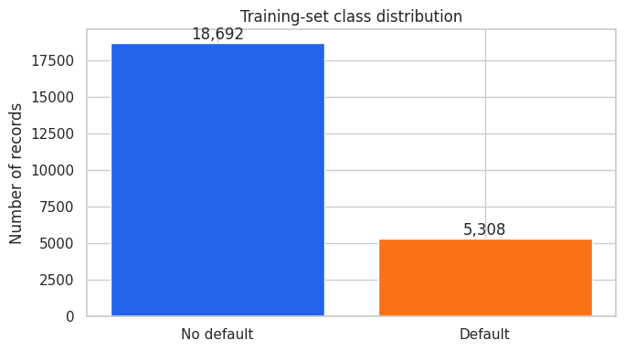
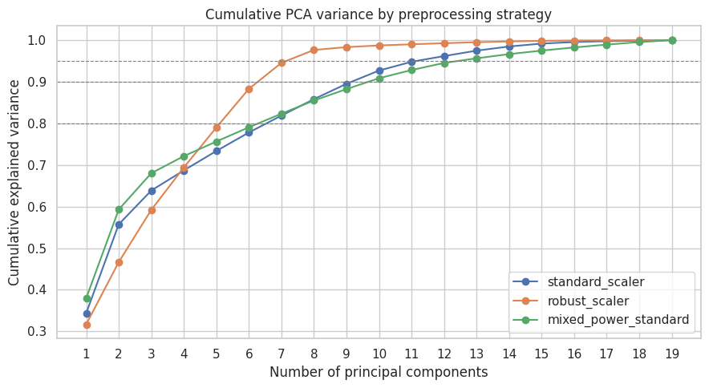
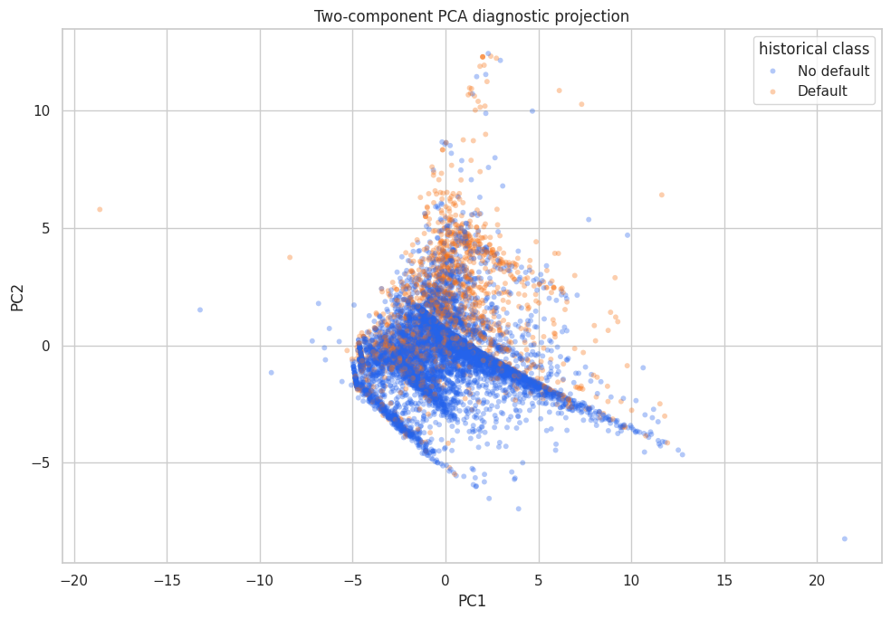
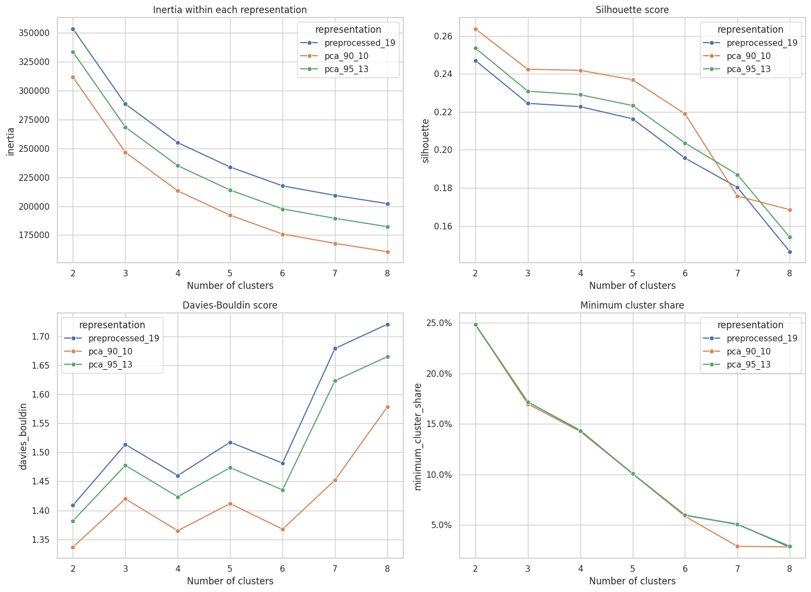
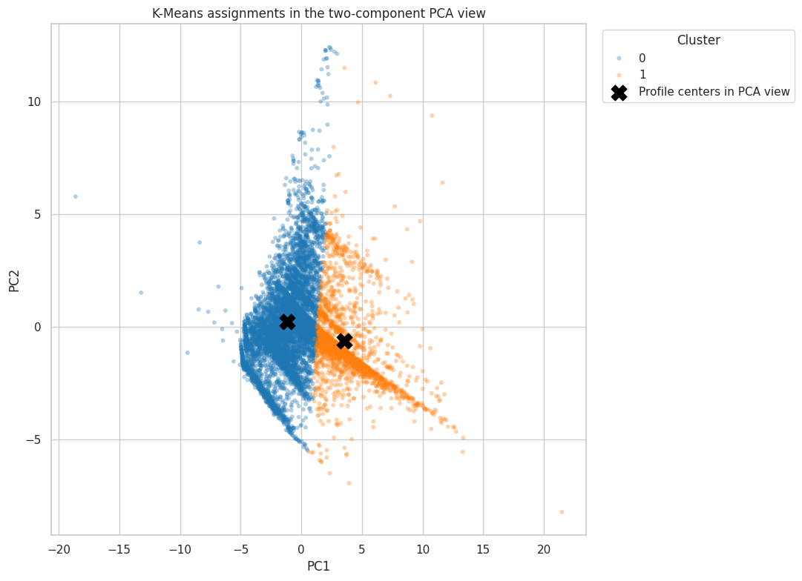
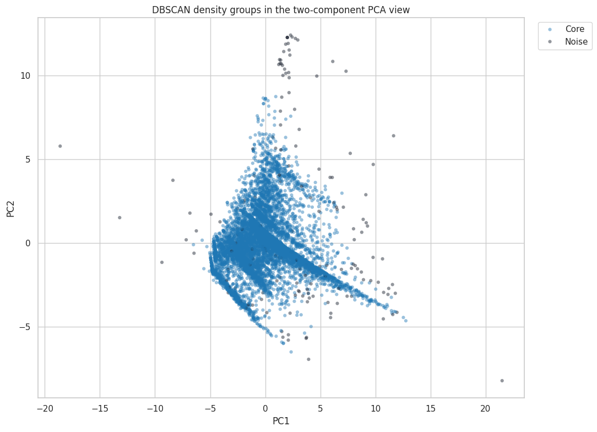
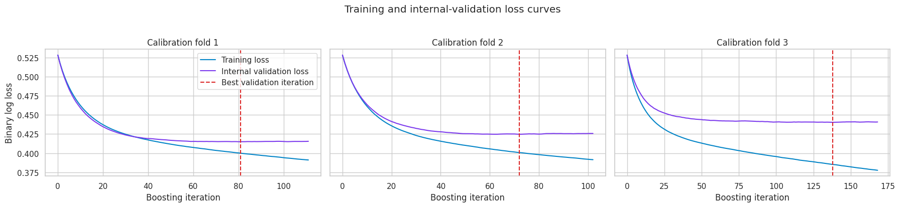
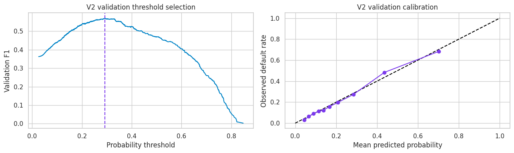
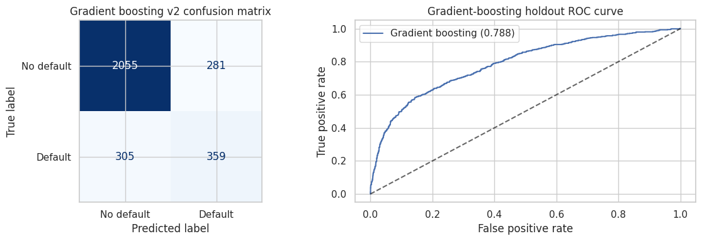

<p align="center">
  
</p>

<h1 align="center">Customer Intelligence</h1>

<p align="center">
  Customer segmentation, anomaly exploration, dimensionality reduction, and calibrated default-risk modeling in one reproducible ML portfolio project.
</p>

<p align="center">
  <a href="ml/notebooks/customer-intelligence.ipynb">Executed notebook</a> |
  <a href="reports/presentation/Customer_Intelligence_ML_Pipeline.pdf">Presentation PDF</a> |
  <a href="reports/presentation/Customer_Intelligence_ML_Pipeline.pptx">Editable PowerPoint</a> |
  <a href="docs/presentation-source.md">Presentation source</a> |
  <a href="reports/figures">Result figures</a>
</p>

<p align="center">
  
  
  
  
</p>

## Project overview

This project studies 30,000 historical credit-card customer records with four complementary machine-learning methods:

- **PCA** reduces 19 behavioral inputs to 13 components while retaining 95.63% of their variance.
- **K-Means** finds two stable behavioral groups for descriptive customer analysis.
- **DBSCAN** identifies unusual multivariate behavior as density noise instead of forcing every record into a cluster.
- **Histogram gradient boosting** estimates historical default risk with feature engineering, probability calibration, early stopping, and validation-based threshold selection.

The entire workflow is available in the [executed Kaggle notebook](ml/notebooks/customer-intelligence.ipynb). The final test set remains isolated until model and threshold selection are complete.

## Why this project matters

Real customer behavior is not one-dimensional. Organizations need to understand broad behavioral groups, unusual records, and uncertain risk estimates without confusing those outputs with proof about an individual. This project demonstrates how unsupervised and supervised methods can be combined while keeping their purposes separate:

| Method | Role in the project | Appropriate interpretation |
|---|---|---|
| PCA | Compress correlated billing, payment, and repayment variables | A lower-dimensional representation, not a customer score |
| K-Means | Describe broad behavioral groups | Segments for analysis, not approval categories |
| DBSCAN | Surface sparse or unusual patterns | Anomaly exploration, not fraud detection |
| Gradient boosting | Estimate default probability from historical behavior | Educational risk modeling, not a production credit decision |

## Dataset and split

The project uses the UCI [Default of Credit Card Clients](https://archive.ics.uci.edu/dataset/350/default+of+credit+card+clients) dataset, distributed under CC BY 4.0.

| Property | Value |
|---|---:|
| Records | 30,000 |
| Raw explanatory features | 23 |
| Historical defaults | 6,636, or 22.12% |
| Training split | 24,000, or 80% |
| Validation split | 3,000, or 10% |
| Test split | 3,000, or 10% |
| Split strategy | Shuffled and target-stratified |
| Random state | 42 |

The split audit found zero identifier overlap. The maximum pairwise absolute standardized mean difference was 0.0742, below the common 0.10 warning level. Rare repayment codes are not represented in every smaller partition, and the notebook reports those gaps explicitly.

<p align="center">
  
</p>

## PCA: dimensionality reduction

Three leakage-safe preprocessing strategies were compared using training data only. The selected mixed power and standard scaling pipeline retained 13 of 19 principal components for 95.63% cumulative explained variance. The first two components explain 59.29%, which makes them useful for visualization but not a complete representation of the dataset.

<p align="center">
  
</p>

<p align="center">
  
</p>

## K-Means: behavioral segmentation

The search compared multiple component representations and cluster counts with silhouette score, Calinski-Harabasz score, Davies-Bouldin score, cluster balance, and initialization stability. The selected configuration uses 10 PCA components and two clusters.

| K-Means result | Value |
|---|---:|
| Selected representation | 10 PCA components |
| Selected clusters | 2 |
| Silhouette score | 0.2638 |
| Mean stability ARI | 0.9960 |
| Smallest cluster share | 24.66% |

The near-perfect stability score means repeated initializations find almost the same assignment. The moderate silhouette score means the groups overlap and should not be described as naturally separated customer types.

<p align="center">
  
</p>

<p align="center">
  
</p>

## DBSCAN: anomaly exploration

No tested DBSCAN configuration produced multiple substantial density clusters. The honest result is therefore an anomaly-exploration setup, not an alternative customer segmentation.

| DBSCAN result | Value |
|---|---:|
| Representation | 5 whitened PCA components |
| `eps` | 1.1526 |
| `min_samples` | 10 |
| Core groups | 1 |
| Density-noise share | 2.08% |

The noise records have unusual combinations of repayment and billing behavior. They are not evidence of fraud or wrongdoing.

<p align="center">
  
</p>

## Supervised model

The classifier uses 54 engineered behavioral features created from 19 non-demographic inputs. Ten histogram-gradient-boosting configurations were compared with three-fold stratified cross-validation. PR-AUC was the primary selection metric because only 22.12% of records belong to the positive class.

The selected model uses:

- Learning rate: 0.05
- Maximum boosting iterations: 600
- Maximum leaf nodes: 15
- Sigmoid probability calibration with three folds
- Early stopping with patience 30
- Validation-selected probability threshold: 0.2916

The three calibrated estimators stopped after 116, 131, and 106 iterations. Their best internal validation iterations were 81, 72, and 138, so increasing the 600-iteration cap would not improve this run.

<p align="center">
  
</p>

## Final test results

The fixed test set was evaluated only after candidate selection, calibration, and threshold selection.

| Metric | Threshold 0.50 | Selected threshold 0.2916 |
|---|---:|---:|
| Accuracy | 82.47% | 80.47% |
| Balanced accuracy | 66.05% | 71.02% |
| Precision | 69.83% | 56.09% |
| Recall | 36.60% | 54.07% |
| F1 score | 48.02% | 55.06% |
| ROC-AUC | 78.77% | 78.77% |
| PR-AUC | 57.13% | 57.13% |
| Brier score | 0.1323 | 0.1323 |
| Log loss | 0.4230 | 0.4230 |

The selected threshold improves recall, balanced accuracy, and F1 by accepting more false positives. The resulting confusion matrix contains 2,055 true negatives, 281 false positives, 305 false negatives, and 359 true positives.

<p align="center">
  
</p>

<p align="center">
  
</p>

### Why the score is not 90%

This dataset contains overlapping customer behavior, class imbalance, rare categories, and identical feature profiles with conflicting outcomes. Twenty-one exact feature profiles have different target labels. That is direct evidence that the available variables do not determine default perfectly. Reporting the measured result is more credible than reaching 90% through leakage, test-set tuning, or majority-class accuracy.

## Reproduce the project

Create an environment and install the dependencies:

```powershell
python -m venv .venv
.\.venv\Scripts\Activate.ps1
python -m pip install -r ml\requirements.txt
```

Run the unit tests:

```powershell
python -m unittest discover -s ml\tests -v
```

Validate a fresh UCI download:

```powershell
python ml\scripts\validate_dataset.py
```

Re-export the saved notebook plots:

```powershell
python ml\scripts\export_notebook_figures.py
```

Regenerate the editable presentation:

```powershell
python -m pip install -r docs\presentation-requirements.txt
python ml\scripts\generate_presentation.py
```

On Windows with Microsoft PowerPoint installed, export the PDF and optional slide previews:

```powershell
.\docs\export_presentation.ps1
```

For Kaggle, upload [customer-intelligence.ipynb](ml/notebooks/customer-intelligence.ipynb), enable Internet access for `ucimlrepo`, and run every cell in order. A GPU session may be enabled, but this scikit-learn workflow executes on the CPU.

## Repository structure

```text
customer-intelligence-ml/
|-- docs/
|   |-- assets/
|   |-- export_presentation.ps1
|   |-- presentation-requirements.txt
|   `-- presentation-source.md
|-- ml/
|   |-- notebooks/customer-intelligence.ipynb
|   |-- scripts/
|   |-- src/customer_intelligence/
|   `-- tests/
|-- reports/
|   |-- figures/
|   `-- presentation/
|-- README.md
|-- codex.md
`-- LICENSE
```

## Presentation support

The repository includes a watermark-free [presentation PDF](reports/presentation/Customer_Intelligence_ML_Pipeline.pdf) and an [editable PowerPoint deck](reports/presentation/Customer_Intelligence_ML_Pipeline.pptx). The 12-slide deck uses the verified notebook plots, includes presenter notes, and can be rebuilt from [generate_presentation.py](ml/scripts/generate_presentation.py).

The [presentation source](docs/presentation-source.md) contains the grounded slide outline, verified metrics, figure references, and interview talking points. It can also be supplied to NotebookLM or Gemini, but generated charts should always be replaced with the exported notebook figures before publication.

## Limitations and responsible use

- This is an educational portfolio project, not a production credit-decision system.
- Demographic attributes are excluded from model inputs and used only for aggregate subgroup auditing.
- Observational associations do not establish causation.
- DBSCAN noise does not imply fraud, misconduct, or future default.
- The dataset is historical and may not represent current populations or policies.
- A real deployment would require governance, monitoring, jurisdiction-specific review, bias assessment, security controls, and documented human oversight.

## License and attribution

Project code is released under the [MIT License](LICENSE). The dataset remains subject to its [CC BY 4.0 license and UCI attribution requirements](https://archive.ics.uci.edu/dataset/350/default+of+credit+card+clients).
